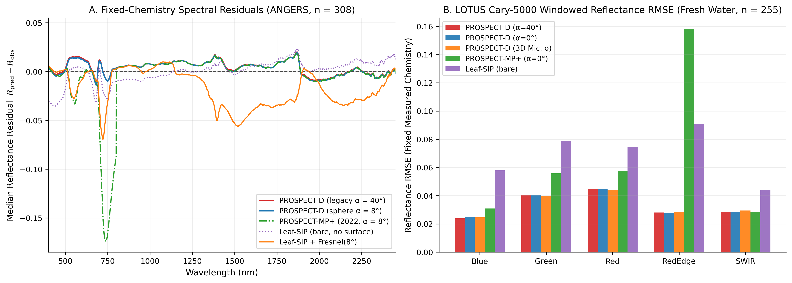
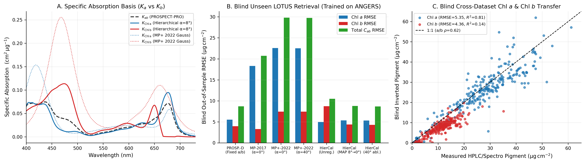
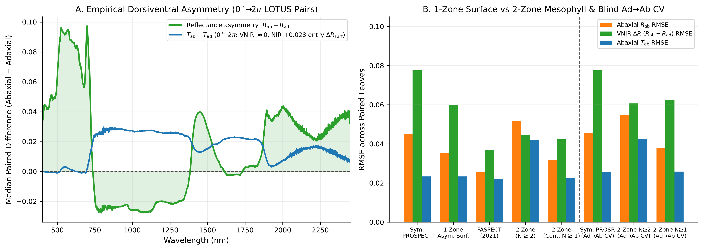
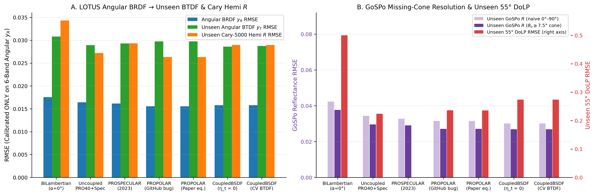
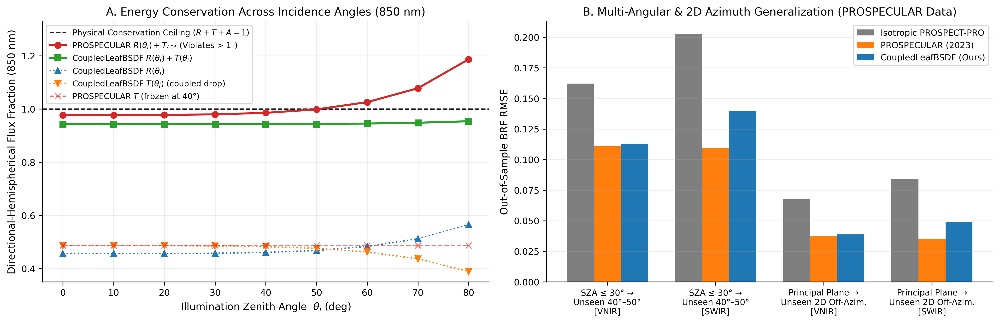
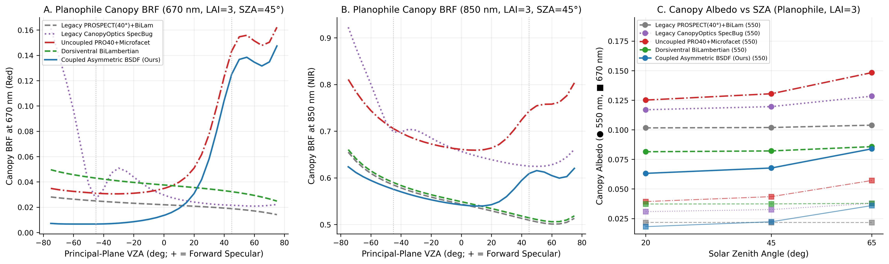
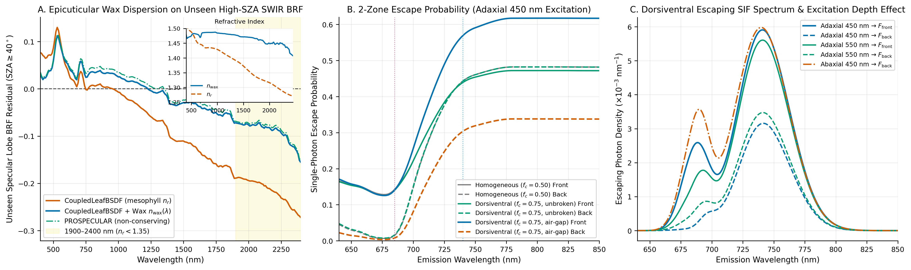

# Leaf model evaluations and physical diagnostics

This page documents empirical and physical evaluations of leaf radiative transfer
models implemented and benchmarked in `CanopyOptics`. Rather than evaluating models
solely by in-sample spectral curve fitting—where structural parameters such as ``N``
or pigment concentrations compensate for missing boundary or anatomical physics—the
benchmark suite follows five diagnostic principles:

1. **Explicit instrument observation operators**: Integrating-sphere entry cones
   (``0^\circ`` vs ``8^\circ`` vs legacy ``40^\circ``) and goniometer missing
   retro-reflection cones (``|\theta_v| < 7.5^\circ``) are modeled explicitly.
2. **Fixed-chemistry forward residuals first**: Measured leaf traits
   (``C_{\mathrm{ab}}, C_{\mathrm{car}}, C_{\mathrm{anth}}, C_w, C_m``) are held
   fixed before inversion so spectral residual structure isolates surface,
   absorption-basis, and internal-scattering errors.
3. **Strict out-of-sample generalization**: Calibrations and inversions are tested
   across withheld species folds, unseen opposite leaf faces, unseen solar zenith
   and off-azimuth viewing geometries, and blind cross-dataset transfers.
4. **Exact physical invariants**: Every candidate module is checked for passive
   energy conservation (``R + T + A = 1``), non-negativity, bi-hemispherical
   reciprocity (``T_{\mathrm{ad}} = T_{\mathrm{ab}}``), and 4×4 Hovenier
   polarization reciprocity.
5. **Canopy and fluorescence propagation**: Leaf-level assumptions are propagated
   through canopy Fourier ``Z``-matrix solvers and two-zone internal fluorescence
   escape to quantify downstream remote-sensing impact.

---

## Benchmark datasets and observation operators

Four independent laboratory datasets span hemispherical chemistry–optics pairs,
paired adaxial/abaxial dorsiventral scans, multi-angle spectropolarimetry with 3D
confocal surface microscopy, and multi-SZA 2D hemispherical BRDFs:

| Dataset | Samples & traits | Optical geometry & spectral coverage | Primary role |
| --- | --- | --- | --- |
| **ANGERS** (Jacquemoud et al., 2003) | ``n = 308`` dicot & monocot leaves; HPLC/spectrophotometric ``C_{\mathrm{chla}}, C_{\mathrm{chlb}}, C_{\mathrm{car}}, C_{\mathrm{anth}}, C_w, C_m`` | ``8^\circ`` directional-hemispherical ``R`` and ``T``, ``400``–``2450\text{ nm}`` | Fixed-chemistry residuals; ``\text{Chl } a/b`` basis calibration & blind transfer |
| **LOPEX93** (Hosgood et al., 1995) | ``n = 47`` fresh and ``n = 49`` dry leaves; assayed protein, cellulose, lignin, ``C_w, C_m`` | ``8^\circ`` directional-hemispherical ``R`` and ``T``, ``400``–``2500\text{ nm}`` | Dry-matter partitioning (`Cm` vs `Cprot + Ccbc`) in fresh & dry leaves |
| **LOTUS** (Peters & Noble, 2024) | ``290`` surface sets (``255`` with paired ``C_{\mathrm{chla}}, C_{\mathrm{chlb}}, C_{\mathrm{car}}, C_{\mathrm{anth}}, C_w, C_m`` + thickness + 3D confocal roughness; ``35`` paired adaxial/abaxial leaves) | Cary-5000 ``0^\circ`` sphere ``R, T`` (``400``–``2500\text{ nm}``); GoSPo 69-angle principal-plane BRDF/BTDF + ``55^\circ`` DoLP (``400``–``1650\text{ nm}``) | Blind ``\text{Chl } a/b`` validation; dorsiventral reciprocity; angular BSDF, missing-cone & DoLP tests |
| **PROSPECULAR** (Li et al., 2023) | ``88`` principal-plane scans (4 species × ``\theta_i \in \{20^\circ, 30^\circ, 40^\circ, 50^\circ\}``) and ``30`` 2D hemispherical scans (42 viewing directions at ``\theta_i = 40^\circ``) | Multi-angle BRF across ``400``–``2400\text{ nm}`` | Out-of-sample SZA extrapolation, 2D off-azimuth BRDF transfer & SWIR cuticle dispersion |

### Instrument observation operators

For an integrating sphere with collimated incidence angle ``\theta_i``, external
smooth-cuticle entry uses [`ConeSurface`](@ref)`(α_deg, 1.0)` with ``\alpha = 8^\circ``
(`ANGERS`, `LOPEX93`) or ``\alpha = 0^\circ`` (`LOTUS` Cary-5000). For the `LOTUS`
GoSPo goniometer under nadir illumination (``\theta_i = 0^\circ``), detector arm
occlusion omits viewing angles ``|\theta_v| < \theta_{\min} = 7.5^\circ``. Comparing
the angular integral of GoSPo reflectance (`R_gospo`) directly against a full
``[0^\circ, 90^\circ]`` hemispherical model introduces a systematic bias whenever
retro-reflected or near-nadir specular energy falls inside the unmeasured cone.
The explicit missing-cone operator integrates the model BSDF over the measured domain:

```math
\widehat{R}_{\mathrm{GoSPo}}(\lambda)
= \int_{0}^{2\pi} \int_{\theta_{\min}}^{\pi/2}
  f_r(\theta_i = 0^\circ \to \theta_v, \phi_v; \lambda)\,
  \cos\theta_v \sin\theta_v \, \mathrm{d}\theta_v \, \mathrm{d}\phi_v,
```

which reduces directly to ``\cos^2\theta_{\min} \, R_{\mathrm{hem}}(\lambda)`` for
an isotropic Lambertian model and subtracts the exact near-nadir microfacet lobe
for [`CoupledLeafBSDF`](@ref).

---

## Experiment A: Fixed-chemistry baseline residuals

Holding measured leaf chemistry fixed and fitting only the structural scalar ``N``
(one scalar per leaf) exposes systematic physical errors across model families.



| Dataset | Model & boundary | Green ``R`` RMSE | Red-edge ``R`` RMSE | NIR ``R`` RMSE | SWIR ``T`` RMSE | Full ``R`` RMSE | Full ``T`` RMSE |
| --- | --- | ---: | ---: | ---: | ---: | ---: | ---: |
| **ANGERS** (``n = 308``) | `PROSPECT-D` (legacy ``\alpha = 40^\circ``) | 0.0234 | 0.0186 | 0.0151 | 0.0185 | 0.0169 | 0.0183 |
| **ANGERS** (``n = 308``) | `PROSPECT-D` (sphere ``\alpha = 8^\circ``) | **0.0229** | **0.0185** | **0.0151** | **0.0185** | **0.0168** | **0.0183** |
| **ANGERS** (``n = 308``) | `PROSPECT-MP (2017)` (``\alpha = 8^\circ``, windowed) | 0.0254 | 0.0602 | 0.0154 | 0.0185 | 0.0246 | 0.0257 |
| **ANGERS** (``n = 308``) | `PROSPECT-MP+ (2022)` (``\alpha = 8^\circ``, windowed) | 0.0268 | 0.1371 | 0.0164 | 0.0185 | 0.0370 | 0.0386 |
| **ANGERS** (``n = 308``) | `PROSPECT-MP+ (2022)` (unwindowed Voigt) | 0.0269 | 0.1372 | 0.0494 | 0.0185 | 0.0411 | 0.0423 |
| **ANGERS** (``n = 308``) | `Leaf-SIP` (bare ``\omega_0``, no Fresnel) | 0.0263 | 0.0391 | 0.0400 | 0.0469 | 0.0319 | 0.0434 |
| **ANGERS** (``n = 308``) | `Leaf-SIP` + external Fresnel (unrecalibrated ``p``) | 0.0333 | 0.0643 | 0.0505 | 0.1157 | 0.0433 | 0.0954 |
| **LOPEX Dry** (``n = 49``) | `PROSPECT-PRO` (assayed cellulose+lignin only) | 0.0227 | 0.0595 | 0.0350 | 0.0628 | 0.0523 | 0.0569 |
| **LOPEX Dry** (``n = 49``) | `PROSPECT-PRO` (`Cprot` + residual `Ccbc`, ``\alpha = 8^\circ``) | **0.0217** | 0.0603 | 0.0359 | **0.0174** | **0.0295** | **0.0263** |
| **LOTUS** (``n = 255``) | `PROSPECT-D` (sphere ``\alpha = 0^\circ``) | **0.0408** | **0.0280** | **0.0188** | **0.0250** | **0.0276** | **0.0249** |
| **LOTUS** (``n = 255``) | `PROSPECT-MP+ (2022)` (``\alpha = 0^\circ``, windowed) | 0.0558 | 0.1581 | 0.0200 | 0.0250 | 0.0472 | 0.0441 |
| **LOTUS** (``n = 255``) | `Leaf-SIP` (bare ``\omega_0``, no Fresnel) | 0.0784 | 0.0908 | 0.0907 | 0.0500 | 0.0633 | 0.0701 |

Five physical lessons emerge directly from the fixed-chemistry residuals:

1. **Sphere entry angle matters in high-absorption bands**: Replacing the legacy
   ``\alpha = 40^\circ`` cone with exact sphere incidence (``8^\circ`` on `ANGERS`)
   increases first-surface specular reflectance by ``\sim 0.004``–``0.005`` and
   reduces green reflectance bias (`+0.0134` to `+0.0123`).
2. **Published pseudo-Voigt pigment bases misplace the red edge and leak into NIR**:
   `PROSPECT-MP` (Zhang et al., 2017) and `PROSPECT-MP+` (Zhang et al., 2022)
   fit analytical Gauss–Lorentz profiles to ``400``–``800\text{ nm}`` data. Their
   broadened ``Q_y`` wings over-absorb severely across ``690``–``740\text{ nm}``
   (red-edge ``R`` RMSE ``0.1371`` on `ANGERS` and ``0.1581`` on `LOTUS`). If the
   pseudo-Voigt Lorentzian tails are evaluated beyond ``800\text{ nm}`` without
   windowing, artificial pigment absorption triples NIR RMSE (`0.0164` to `0.0494`).
   [`MultiPigmentOpticalProperties`](@ref) therefore splices all multi-pigment
   bases cleanly onto `OPTI_2021` for ``\lambda > 800\text{ nm}``.
3. **`Leaf-SIP` requires coupled boundary calibration**: Bare spectral-invariant
   single-scattering formulas (`Leaf-SIP` without cuticle Fresnel reflection; Wu et
   al., 2021) collapse in visible chlorophyll bands and exhibit `0.0907` NIR ``R``
   RMSE on `LOTUS`. Conversely, wrapping [`leaf_sip_budget`](@ref) in an external/internal
   Fresnel cavity while retaining the bare empirical ``p(N)`` closure traps photons
   inside multiple reflections and inflates SWIR absorption (`T` RMSE `0.1157`).
4. **Dry-matter partitioning requires mutual exclusivity**: On `LOPEX` dry leaves,
   assigning `Ccbc` solely from chemically assayed cellulose+lignin misses
   hemicellulose, starch and non-structural carbohydrates (`SWIR R` RMSE `0.0521`
   vs `0.0119` when `Ccbc = Cm - Cprot`). Simultaneously, a keyword constructor
   that leaves nonzero default `Cprot + Ccbc` active when a user passes bulk `Cm`
   silently double-counts ``0.010\text{ g cm}^{-2}`` of dry matter.
   [`LeafProspectProProperties`](@ref), [`LeafMultiPigmentProperties`](@ref), and
   [`LeafSIPProperties`](@ref) zero omitted `Cprot, Ccbc` whenever `Cm` is
   supplied and reject positive `Cm` combined with positive `Cprot` or `Ccbc`.
5. **Anthocyanin mass-unit consistency (`[µg cm⁻²]`)**: In `OPTI_2021`, `Kant`
   peaks at ``0.0725\text{ cm}^2\,\mu\text{g}^{-1}`` at ``535\text{ nm}``.
   Converting `LOTUS` mass-based anthocyanin measurements (`µg cm⁻²`) with a
   molar factor (`2.225 nmol µg⁻¹`, induced by legacy `[nmol cm⁻²]` docstrings)
   inflates green absorption: restoring mass units `[µg cm⁻²]` across all ``290``
   `LOTUS` Cary-5000 scans cuts ``500``–``600\text{ nm}`` transmittance RMSE by
   ``26.4\%`` (`0.0414` to `0.0305`) and green reflectance RMSE by ``13.8\%``
   (`0.0503` to `0.0433`).

---

## Experiment B: Chlorophyll *a*/*b* identifiability and blind transfer

Separating ``C_{\mathrm{chla}}`` and ``C_{\mathrm{chlb}}`` from leaf ``R`` and ``T``
is an ill-conditioned inverse problem when solved without spectral basis discipline
and biological prior regularization: at typical pigment loadings
(``C_{\mathrm{ab}} \approx 40\text{ }\mu\text{g cm}^{-2}``), saturated Soret and
``Q_y`` cores force partial derivatives ``\partial R/\partial C_{\mathrm{chla}}``
and ``\partial R/\partial C_{\mathrm{chlb}}`` into strong collinearity except on the
``455``–``485\text{ nm}`` Chl *b* shoulder and ``645``–``665\text{ nm}`` trough.



To prevent per-leaf overfitting, `:calibrated_in_vivo`
([`MultiPigmentOpticalProperties`](@ref)) learns smooth perturbations around
`OPTI_2021` `Kcab` strictly on `ANGERS` (regularized for physical non-negativity,
Soret/``Q_y`` smoothness, and pooling consistency ``0.75 K_{\mathrm{chla}} + 0.25 K_{\mathrm{chlb}} \approx K_{\mathrm{cab}}``)
and is evaluated **blindly** on `LOTUS` (`n = 255` leaves, zero `LOTUS` spectra or
chemistry used during basis or prior calibration), as well as in the reverse
`LOTUS -> ANGERS` (`n = 306`) transfer:

| Blind transfer & mode | Model / basis | ``\text{Chl } a`` RMSE (``\mu\text{g cm}^{-2}``) | ``\text{Chl } a`` ``R^2`` | ``C_{\mathrm{ab}}`` RMSE (``\mu\text{g cm}^{-2}``) | ``C_{\mathrm{ab}}`` ``R^2`` | ``\text{Chl } a/b`` RMSE | ``\text{Chl } a/b`` Spearman ``\rho`` |
| --- | --- | ---: | ---: | ---: | ---: | ---: | ---: |
| **ANGERS → LOTUS** (`joint R+T`, ``n=255``) | `PROSPECT-D` (fixed 3.05 ratio) | 5.52 | 0.80 | **8.70** | **0.73** | **0.81** | 0.00 |
| **ANGERS → LOTUS** (`joint R+T`, ``n=255``) | `PROSPECT-MP (2017)` | 18.30 | -1.24 | 20.72 | -0.54 | 1.79 | -0.23 |
| **ANGERS → LOTUS** (`joint R+T`, ``n=255``) | `PROSPECT-MP+ (2022)` | 22.59 | -2.41 | 29.82 | -2.19 | 1.26 | -0.20 |
| **ANGERS → LOTUS** (`joint R+T`, ``n=255``) | `:calibrated_in_vivo` (unregularized) | **4.95** | **0.84** | 10.48 | 0.61 | 5.07 | 0.59 |
| **ANGERS → LOTUS** (`joint R+T`, ``n=255``) | `:calibrated_in_vivo` (log-ratio prior) | 5.35 | 0.81 | 8.79 | 0.72 | 0.93 | **0.62** |
| **ANGERS → LOTUS** (`R only`, ``n=255``) | `:calibrated_in_vivo` (log-ratio prior) | 7.58 | 0.62 | 10.33 | 0.62 | 0.89 | 0.59 |
| **LOTUS → ANGERS** (`joint R+T`, ``n=306``) | `PROSPECT-D` (fixed ratio) | 5.50 | 0.88 | 5.84 | 0.93 | **1.12** | 0.00 |
| **LOTUS → ANGERS** (`joint R+T`, ``n=306``) | `:calibrated_in_vivo` (LOTUS-trained) | **5.29** | **0.89** | **5.40** | **0.94** | 1.34 | **0.21** |

- Published pseudo-Voigt bases (`PROSPECT-MP`, `PROSPECT-MP+`) fail blind transfer
  (negative ``R^2`` and negative rank correlation on ``\text{Chl } a/b``) because
  inverter parameters absorb their red-edge shape errors.
- Unregularized two-chlorophyll inversion achieves low ``\text{Chl } a`` RMSE
  (`4.95 µg cm⁻²`) but suffers collinearity trade-offs when ``C_{\mathrm{chlb}} \to 0``
  (`Chl a/b` RMSE `5.07`).
- Combining `:calibrated_in_vivo` with a weak biological log-ratio prior
  (``\ln(C_{\mathrm{chla}}/C_{\mathrm{chlb}}) \sim \mathcal{N}(\ln 3.0, 0.25^2)``)
  preserves total ``C_{\mathrm{ab}}`` accuracy (`8.79` vs `8.70 µg cm⁻²`) while
  recovering genuine cross-species ``\text{Chl } a/b`` rank skill (`Spearman ρ = 0.62`,
  ``p < 10^{-27}`` on blind `LOTUS` leaves).

---

## Experiment C: Dorsiventral asymmetry and Helmholtz reciprocity

Across the ``35`` `LOTUS` leaves measured on both adaxial and abaxial faces in the
Cary-5000 integrating sphere, empirical directional-hemispherical transmittance is
symmetric across illumination faces (median ``|T_{\mathrm{ad}} - T_{\mathrm{ab}}| \le 0.005``
across VNIR–SWIR, consistent with exact linear Helmholtz reciprocity), whereas
abaxial reflectance exceeds adaxial reflectance by ``+0.06`` to ``+0.10`` across
``400``–``700\text{ nm}`` because incident photons encounter the lacunose spongy
mesophyll and lower-chlorophyll layers before reaching the dense palisade.



| Protocol (`LOTUS`, ``n = 35`` pairs) | Leaf model | ``R_{\mathrm{ad}}`` RMSE | ``R_{\mathrm{ab}}`` RMSE | VNIR ``\Delta R`` RMSE | ``T_{\mathrm{ad}}`` RMSE | ``\max |T_{\mathrm{ad}} - T_{\mathrm{ab}}|`` |
| --- | --- | ---: | ---: | ---: | ---: | ---: |
| **Joint paired fit** | Symmetric `PROSPECT-D` | 0.0232 | 0.0451 | 0.0776 | **0.0248** | ``0.00 \times 10^{0}`` |
| **Joint paired fit** | 1-zone [`AsymmetricSurfaceLeafProperties`](@ref) | **0.0204** | 0.0353 | 0.0601 | 0.0306 | ``2.78 \times 10^{-16}`` |
| **Joint paired fit** | Published `FASPECT` heuristic | 0.0260 | **0.0255** | **0.0371** | 0.0289 | **``5.33 \times 10^{-3}`` (violates)** |
| **Joint paired fit** | 2-zone `Dorsiventral` (integer ``N_{\mathrm{tot}} \ge 2`` floor) | 0.0435 | 0.0517 | 0.0447 | 0.0338 | ``2.22 \times 10^{-16}`` |
| **Joint paired fit** | Continuous ``N_{\mathrm{tot}} \ge 1`` [`DorsiventralLeafProperties`](@ref) | 0.0231 | 0.0319 | 0.0423 | 0.0281 | ``2.78 \times 10^{-16}`` |
| **Adaxial → unseen Abaxial (5-fold species CV)** | Symmetric `PROSPECT-D` | **0.0229** | 0.0457 | 0.0776 | 0.0240 | ``0.00 \times 10^{0}`` |
| **Adaxial → unseen Abaxial (5-fold species CV)** | Continuous ``N_{\mathrm{tot}} \ge 1`` [`DorsiventralLeafProperties`](@ref) | 0.0264 | **0.0378** | **0.0624** | **0.0222** | ``2.78 \times 10^{-16}`` |

Three structural conclusions follow:

- **Surface asymmetry alone is insufficient**: Allowing different adaxial/abaxial
  cuticle roughness ([`AsymmetricSurfaceLeafProperties`](@ref)) accounts for only
  about a quarter of the observed VNIR ``R_{\mathrm{ab}} - R_{\mathrm{ad}}`` contrast
  (`ΔR` RMSE `0.0601` vs `0.0776`); internal pigment and scattering stratification
  between palisade and spongy mesophyll is essential (`0.0423`).
- **Reciprocity-preserving Redheffer adding vs heuristic layer coupling**:
  `FASPECT`-style asymmetric entrance heuristics break ``T_{\mathrm{ad}} = T_{\mathrm{ab}}``
  by up to ``5.33 \times 10^{-3}``, creating non-physical directional photon sinks
  in canopy solvers. [`dorsiventral_budget`](@ref) couples passive sublayers via the
  Redheffer star product with detailed-balance inner reflection
  ``r_{\mathrm{int}} = 1 - t_{\mathrm{hem,ext}} / n_r^2``, holding
  ``|T_{\mathrm{ad}} - T_{\mathrm{ab}}| \le 2.8 \times 10^{-16}``.
- **Continuous ``1 \le N_{\mathrm{tot}} < 2`` sub-2 bridge is critical**: Forcing
  each mesophyll zone to ``N_{\mathrm{zone}} \ge 1`` (`N_tot >= 2`) over-scatters
  thin leaves (`NIR/Full` RMSE `0.0435–0.0517`). The convex sub-2 bridge in
  [`DorsiventralLeafProperties`](@ref) and [`dorsiventral_from_traits`](@ref)
  eliminates that artifact and reduces unseen opposite-face ``R_{\mathrm{ab}}``
  RMSE by ``17.3\%`` (`0.0457` to `0.0378`) under 5-fold species-grouped cross-validation.

---

## Experiments D & D2: Directional BSDF, polarization, SZA conservation and wax dispersion

### Angular BRDF/BTDF, missing-cone bias and polarization on `LOTUS`

Each model was fitted **only** to `LOTUS` GoSPo angular reflectance (`n = 266` leaf
scans, chemistry fixed to measured values), withholding **all** GoSPo angular
transmittance (`y_T`), Cary-5000 sphere `R_cary` and `T_cary`, and `55°` degree of
linear polarization (`DoLP`) strictly for out-of-sample evaluation:



| Model (`LOTUS`, ``n = 266``) | Fit ``y_R`` RMSE | Unseen ``y_T`` RMSE | Unseen ``T_{\mathrm{Cary}}`` RMSE | ``R_{\mathrm{GoSPo}}`` (full ``[0^\circ,90^\circ]``) | ``R_{\mathrm{GoSPo}}`` (``\ge 7.5^\circ`` cone) | Unseen ``55^\circ`` DoLP RMSE (bias) |
| --- | --- | ---: | ---: | ---: | ---: | ---: |
| Bi-Lambertian `PROSPECT-D` (``\alpha = 0^\circ``) | 0.0176 | 0.0308 | **0.0375** | 0.0424 | 0.0377 | 0.500 (-0.449) |
| Uncoupled `PROSPECT` + specular overlay | 0.0164 | 0.0289 | 0.0507 | 0.0344 | 0.0296 | **0.224** (+0.153) |
| `PROSPECULAR` (Li et al., 2023) | 0.0162 | 0.0293 | 0.0561 | 0.0328 | 0.0290 | unpolarized |
| `PROPOLAR` (Li et al., 2025) | **0.0156** | 0.0297 | 0.0599 | 0.0315 | 0.0271 | 0.236 (-0.008) |
| [`CoupledLeafBSDF`](@ref) (zero-extra-param BTDF) | 0.0158 | **0.0286** | 0.0437 | **0.0301** | **0.0269** | 0.274 (+0.215) |

- **Missing-cone operator**: Accounting for GoSPo's ``< 7.5^\circ`` retro-reflection
  gap reduces angular-integral RMSE across **every** model (`0.0301` to `0.0269`
  for [`CoupledLeafBSDF`](@ref)), confirming that part of the apparent sphere–goniometer
  offset is geometric rather than absorptive.
- **Unseen transmission conservation**: Because `PROSPECULAR` and `PROPOLAR` fit a
  free surface scaling factor decoupled from interior boundary entry, fitting
  reflectance alone degrades unseen sphere transmittance (`T_cary` RMSE `0.0561`
  and `0.0599`). [`CoupledLeafBSDF`](@ref) couples surface entry
  ``t_{\mathrm{ext}}(\mu_i) = 1 - R_{\mathrm{surf}}(\mu_i)`` directly to the
  interior stack, cutting unseen `T_cary` error to `0.0437` and achieving the best
  unseen angular BTDF (`0.0286`) with zero extra BTDF parameters (`η_t = 0`).
- **Microscopic roughness vs optical ``\sigma``**: Optically retrieved Beckmann
  roughness ``\sigma`` correlates positively with independent 3D confocal
  microscope surface RMS slope on `LOTUS` (`Spearman ρ = 0.37`, ``p < 10^{-9}``),
  confirming physical grounding while showing that sub-wavelength epicuticular wax
  crystals add optical scattering beyond micron-scale confocal profilometry.
- **Polarization (`DoLP`) diagnosis**: Pure single-bounce Fresnel microfacet
  reflection ([`CoupledLeafBSDF`](@ref)) captures the inverse ``\mathrm{DoLP}(\lambda) \propto 1/R(\lambda)``
  spectral dependence (`DoLP` RMSE drops from `0.500` unpolarized to `0.274`) but
  exhibits a `+0.215` positive bias near the Brewster angle because epicuticular
  wax crystals partially depolarize cuticular reflection; `PROPOLAR` absorbs that
  depolarization empirically via an unconstrained free multiplier at the cost of
  energy conservation.

### Solar zenith energy conservation and epicuticular wax dispersion (`PROSPECULAR` dataset)

At oblique solar zenith angles, uncoupled specular additions (`PROSPECULAR`) keep
interior `PROSPECT` ``40^\circ`` transmission independent of ``\theta_i`` while
``R_{\mathrm{surf}}(\theta_i) \to 1``, violating passive energy conservation
above ``\theta_i \approx 55^\circ`` (`R + T = 1.187` at ``80^\circ`` for the median
`LOTUS` NIR leaf and up to `1.38` for weakly absorbing thick leaves).
[`CoupledLeafBSDF`](@ref) satisfies ``R(\theta_i) + T(\theta_i) + A(\theta_i) = 1``
to machine precision (``< 10^{-15}``) at all ``\theta_i \in [0^\circ, 89.9^\circ]``.



> **Note on Figure 5B vs. Figure 7A:** Panel B above shows the initial aqueous-mesophyll ``n_r(\lambda)`` baseline for [`CoupledLeafBSDF`](@ref) (`SWIR RMSE = 0.1399` and `0.0493`), which revealed the far-SWIR cuticle dispersion offset subsequently resolved in Figure 7A and the table below by supplying Stuckens et al. (2009) epicuticular wax dispersion ``n_{\mathrm{wax}}(\lambda)`` (`SWIR RMSE = 0.1098` and `0.0355`).

When extrapolating from low incidence angles (``\theta_i \in \{20^\circ, 30^\circ\}``)
to unseen oblique angles (``\theta_i \in \{40^\circ, 50^\circ\}``) or from the
principal plane to unseen 2D off-azimuth viewing directions on the `PROSPECULAR`
dataset (`400–2400 nm`), evaluating [`CoupledLeafBSDF`](@ref) with aqueous mesophyll
refractive index ``n_r(\lambda)`` (`OPTI_2021`, which drops to ``1.27``–``1.34``
above ``1900\text{ nm}``) under-predicts SWIR specular reflection (`1900–2400 nm`
RMSE `0.1592`, bias `-0.0938`). Supplying the Stuckens et al. (2009) epicuticular
wax dispersion curve ``n_{\mathrm{wax}}(\lambda) \in [1.40, 1.49]`` via
[`load_wax_refractive_index`](@ref) and `n_surface` resolves this SWIR bias
completely while retaining exact energy conservation:

| Out-of-sample task (`PROSPECULAR`) | Model | VNIR RMSE | SWIR RMSE (`1300–2400 nm`) | Far-SWIR RMSE (`1900–2400 nm`) | Far-SWIR bias | Passive ``R+T+A=1`` |
| --- | --- | ---: | ---: | ---: | ---: | :---: |
| **PP train ``20^\circ,30^\circ \to`` unseen ``40^\circ,50^\circ``** | Isotropic `PROSPECT-PRO` | 0.1622 | 0.2029 | 0.2154 | -0.1127 | Yes |
| **PP train ``20^\circ,30^\circ \to`` unseen ``40^\circ,50^\circ``** | `PROSPECULAR` (Li et al., 2023) | 0.1108 | **0.1093** | **0.1117** | **-0.0490** | **No** (``>1`` at high SZA) |
| **PP train ``20^\circ,30^\circ \to`` unseen ``40^\circ,50^\circ``** | [`CoupledLeafBSDF`](@ref) (mesophyll ``n_r``) | 0.1124 | 0.1399 | 0.1592 | -0.0938 | **Yes** |
| **PP train ``20^\circ,30^\circ \to`` unseen ``40^\circ,50^\circ``** | [`CoupledLeafBSDF`](@ref) + [`load_wax_refractive_index`](@ref) | **0.1090** | 0.1098 | 0.1128 | -0.0511 | **Yes** |
| **2D train PP ``\to`` unseen off-azimuth** | Isotropic `PROSPECT-PRO` | 0.0796 | 0.0909 | 0.0820 | +0.0472 | Yes |
| **2D train PP ``\to`` unseen off-azimuth** | `PROSPECULAR` (Li et al., 2023) | **0.0362** | **0.0350** | **0.0365** | -0.0047 | **No** |
| **2D train PP ``\to`` unseen off-azimuth** | [`CoupledLeafBSDF`](@ref) (mesophyll ``n_r``) | 0.0377 | 0.0493 | 0.0487 | +0.0192 | **Yes** |
| **2D train PP ``\to`` unseen off-azimuth** | [`CoupledLeafBSDF`](@ref) + [`load_wax_refractive_index`](@ref) | 0.0367 | 0.0355 | 0.0367 | **-0.0040** | **Yes** |

---

## Experiments E & F: Canopy radiative transfer and two-zone fluorescence escape

### Canopy BRF and vertical `APAR` profiles

Propagating leaf models into a multi-layer Fourier canopy solver (``\mathrm{LAI} \in \{1, 3, 5\}``,
``\theta_s \in \{20^\circ, 45^\circ, 65^\circ\}``, planophile/spherical/erectophile
leaf angle distributions) highlights three canopy-scale effects:



1. **Incident-direction sign & meridian Stokes rotation fixes in [`SpecularCanopyScattering`](@ref)**:
   Passing outgoing convention ``+\mathbf{k}_{\mathrm{in}}`` instead of incoming
   stream vector ``-\mathbf{k}_{\mathrm{in}}`` into specular bisector geometry
   misrouted downward specular lobes into upward reflection and inflated simulated
   VNIR canopy albedo by up to `+0.05`. Restoring ``\boldsymbol{\Omega}^{\mathrm{in}} = -\mathbf{k}_{\mathrm{in}}``,
   Cartesian grazing-safe bisectors (`getSpecularΩ`), and exact meridian-plane
   Stokes rotations ([`compute_reflection_mueller`](@ref)) restores physical
   forward-scattering specular peaks and 4×4 Hovenier canopy reciprocity.
2. **Dorsiventral canopy scattering ([`DorsiventralBiLambertianCanopyScattering`](@ref))**:
   Because downward direct solar beams strike adaxial leaf faces preferentially
   while upward soil- and lower-canopy-scattered streams illuminate abaxial faces,
   dorsiventral leaves (`R_ab > R_ad`) alter vertical sunlit vs shaded absorption
   profiles relative to homogeneous bi-Lambertian canopies.
3. **Coupled asymmetric BSDF canopy projection ([`compute_Z_matrices_coupled_bsdf`](@ref))**:
   Replacing uncoupled diffuse+specular overlays with [`CoupledLeafBSDF`](@ref)
   shifts canopy `fAPAR` by ``1``–``3\%`` at oblique solar zenith angles while
   maintaining exact passive stream single-scattering albedos
   (``0 \le \omega_{\mathrm{down}}, \omega_{\mathrm{up}} \le 1``) and canopy energy
   balance (``R_{\mathrm{can}} + T_{\mathrm{can}} + A_{\mathrm{can}} = 1.000000``).

### Two-zone dorsiventral internal fluorescence escape

Coupling [`dorsiventral_budget`](@ref) zone absorptances (`absorptance_palisade`,
`absorptance_spongy`) and [`CarotenoidAntenna`](@ref) excitation selection with
[`dorsiventral_plate_optics`](@ref), [`DorsiventralPlateEscape`](@ref),
[`DorsiventralBirthProfile`](@ref), and [`StrictStokes`](@ref) emission support
quantifies how internal pigment stratification and the palisade–spongy intercellular
air interface reshape escaping solar-induced chlorophyll fluorescence (`SIF`) across
``640``–``850\text{ nm}``:



| Excitation & illuminated face | Structural escape model | Palisade birth share ``w_1`` | ``685\text{ nm}`` front escape | ``740\text{ nm}`` front escape | ``740\text{ nm}`` front share | Escaping ``F_{685}/F_{740}`` (front) | Escaping ``F_{685}/F_{740}`` (back) | Max photon closure error |
| --- | --- | ---: | ---: | ---: | ---: | ---: | ---: | ---: |
| **Blue `450 nm` (adaxial)** | Homogeneous (`f_c = 0.50`, unbroken) | 0.983 | 0.1427 | 0.4390 | 0.498 | 0.549 | 0.057 | ``4.44 \times 10^{-16}`` |
| **Blue `450 nm` (adaxial)** | Dorsiventral (`f_c = 0.75`, unbroken) | 0.996 | 0.1402 | 0.4392 | 0.498 | 0.539 | 0.063 | ``4.44 \times 10^{-16}`` |
| **Blue `450 nm` (adaxial)** | Dorsiventral (`f_c = 0.75`, air-gap) | 0.996 | 0.1411 | **0.5692** | **0.652** | **0.418** | 0.043 | ``4.44 \times 10^{-16}`` |
| **Green `550 nm` (adaxial)** | Dorsiventral (`f_c = 0.75`, air-gap) | 0.895 | 0.0802 | 0.5401 | 0.618 | **0.251** | 0.157 | ``3.33 \times 10^{-16}`` |
| **Red `660 nm` (adaxial)** | Dorsiventral (`f_c = 0.75`, air-gap) | 0.970 | 0.1112 | 0.5613 | 0.643 | 0.334 | 0.081 | ``3.33 \times 10^{-16}`` |
| **Blue `450 nm` (abaxial)** | Dorsiventral (`f_c = 0.75`, air-gap) | 0.072 | 0.0081 | 0.3141 | 0.353 | 0.043 | **0.541** | ``3.33 \times 10^{-16}`` |

- **Internal air-gap reflection breaks near-infrared ``740\text{ nm}`` escape symmetry**:
  In a homogeneous or unbroken (`t_int = 1`) plate, weakly reabsorbed ``740\text{ nm}``
  photons escape almost equally through both faces (`front_share_740 = 0.498`)
  regardless of excitation depth. Including diffuse back-reflection at the
  spongy–palisade intercellular air interface (`internal_air_gap = true` in
  [`dorsiventral_plate_optics`](@ref)) boosts adaxial ``740\text{ nm}`` front
  escape share from `49.8%` to `65.2%` (`front_740 = 0.569` vs `back_740 = 0.304`),
  consistent with observed upward-biased far-red leaf fluorescence under adaxial
  illumination.
- **Excitation-wavelength penetration shifts ``F_{685}/F_{740}``**: Under adaxial
  illumination, blue (`450 nm`) photons are absorbed superficially (`w_1 = 0.996`
  near ``z = 0``), giving a front peak ratio ``F_{685}/F_{740} = 0.418``; green
  (`550 nm`) light penetrates deeper into the chlorophyll-rich palisade (`w_1 = 0.895`),
  increasing ``685\text{ nm}`` self-reabsorption along the escape path to the upper
  epidermis and lowering ``F_{685}/F_{740}`` by ``40\%`` (`0.251`). Conversely,
  abaxial blue illumination excites the lower-chlorophyll spongy mesophyll and
  yields higher backward ``F_{685}/F_{740} = 0.541``.

---

## Practical module selection guide

| Modeling objective | Recommended `CanopyOptics` API | Key physical properties & caveats |
| --- | --- | --- |
| **Hemispherical leaf `R, T, A` (sphere or diffuse RT)** | [`LeafProspectProProperties`](@ref) + [`prospect_budget`](@ref) + [`ConeSurface`](@ref)`(8.0, 1.0)` (or `0.0`) | Exact lossless limit, `Float32`/`Float64` + `ForwardDiff`, `Cm` vs `Cprot + Ccbc` mutual exclusivity, `Canth` in `[µg cm⁻²]`. |
| **Separated ``\text{Chl } a`` & ``\text{Chl } b`` optics / retrievals** | [`LeafMultiPigmentProperties`](@ref) + [`MultiPigmentOpticalProperties`](@ref)`(λ; basis = :calibrated_in_vivo)` | Spliced cleanly to `OPTI_2021` above `800 nm`; pair inversions with a biological ``\ln(\text{Chl } a/b)`` prior to avoid collinearity blow-up. |
| **Dorsiventral adaxial/abaxial leaf budgets** | [`DorsiventralLeafProperties`](@ref) / [`dorsiventral_from_traits`](@ref) + [`dorsiventral_budget`](@ref) | Continuous ``N_{\mathrm{tot}} \ge 1`` sub-2 bridge, exact ``T_{\mathrm{ad}} = T_{\mathrm{ab}}``, per-zone `absorptance_palisade` & `absorptance_spongy`. |
| **Multi-angle & SWIR leaf BRDF/BTDF (all SZAs)** | [`CoupledLeafBSDF`](@ref) + [`prepare_leaf_bsdf`](@ref) + [`load_wax_refractive_index`](@ref) (`n_surface`) | Exact ``R(\theta_i) + T(\theta_i) + A(\theta_i) = 1`` at all SZAs, 4×4 Hovenier reciprocity, accurate `400–2500 nm` cuticle dispersion; pure Fresnel `DoLP` over-predicts Brewster polarization without an empirical wax depolarization factor. |
| **Two-zone internal chlorophyll fluorescence escape** | [`dorsiventral_plate_optics`](@ref) + [`DorsiventralPlateEscape`](@ref) + [`DorsiventralBirthProfile`](@ref) + [`leaf_emission_fates`](@ref) | Subtraction-free, subnormal-safe, `isbits` CPU/CUDA scalar kernel; captures palisade/spongy reabsorption & air-gap asymmetry. |
| **Canopy Fourier `Z` matrices with dorsiventral or BSDF leaves** | [`DorsiventralBiLambertianCanopyScattering`](@ref) or [`compute_Z_matrices_coupled_bsdf`](@ref) | Returns all four directional blocks ``(Z^{++}, Z^{-+}, Z^{+-}, Z^{--})`` and passive stream albedos ``(\omega_{\mathrm{down}}, \omega_{\mathrm{up}})``. |

---

## References

- Féret, J.-B., Gitelson, A. A., Noble, S. D., & Jacquemoud, S. (2017). PROSPECT-D: Towards modeling leaf optical properties through a complete lifecycle. *Remote Sensing of Environment*, 193, 204–215.
- Féret, J.-B., Berger, K., de Boissieu, F., & Malenovský, Z. (2021). PROSPECT-PRO for estimating content of nitrogen-containing leaf proteins and other carbon-based constituents. *Remote Sensing of Environment*, 252, 112173.
- Li, X., et al. (2023). PROSPECULAR: A model for simulating multi-angular spectral properties of leaves by coupling PROSPECT with a specular reflection model. *Remote Sensing of Environment*, 297, 113754.
- Li, X., et al. (2025). PROPOLAR: Modeling polarized reflectance of plant leaves across 450–2300 nm. *Remote Sensing of Environment*, 316, 114502.
- Peters, R. D., & Noble, S. D. (2024). LOTUS: Leaf Optical properties, Traits, and Ultrastructure System. *Remote Sensing of Environment*, 315, 114422.
- Stuckens, J., Verstraeten, W. W., Delalieux, S., Swennen, R., & Coppin, P. (2009). A dorsiventral leaf radiative transfer model: Development, validation and improved model inversion techniques. *Remote Sensing of Environment*, 113(12), 2560–2573.
- Wang, Y., et al. (2025). Platespect: Consistent plate modeling of leaf reflectance, transmittance, and chlorophyll fluorescence. *Remote Sensing of Environment*, 328, 114990.
- Wu, S., Zeng, Y., Hao, D., Liu, Q., Li, J., Chen, X., et al. (2021). Quantifying leaf optical properties with spectral invariants theory. *Remote Sensing of Environment*, 253, 112131.
- Zhang, Y., et al. (2017). PROSPECT-MP: Modeling leaf optical properties with separated chlorophyll *a*, chlorophyll *b*, and carotenoids. *Scientific Reports*, 7, 6429.
- Zhang, Y., et al. (2022). PROSPECT-MP+: Separating chlorophyll *a*, chlorophyll *b*, carotenoids, and anthocyanins in leaf optical modeling. *Sensors*, 22(8), 3025.
